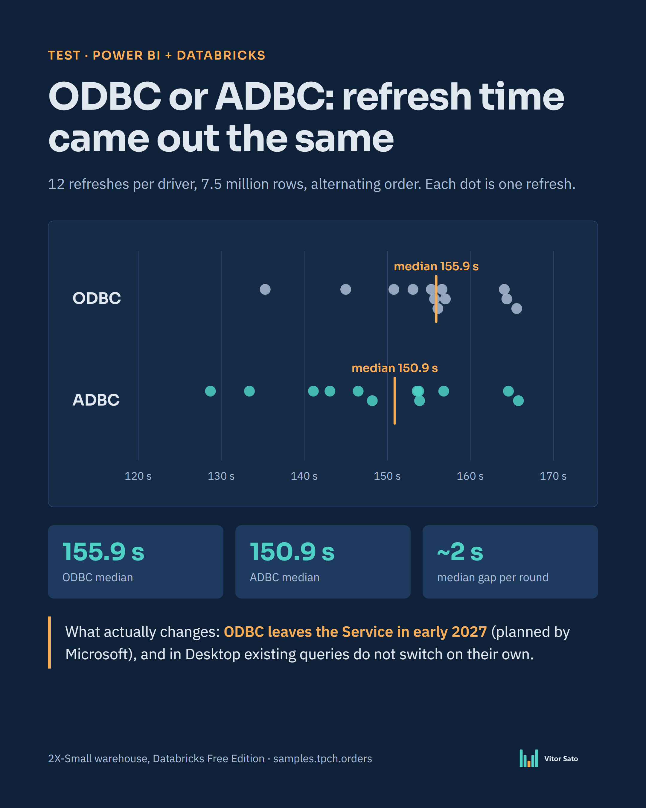

# ODBC or ADBC? Power BI refresh time against Databricks

**Power BI · Power Query · Databricks SQL · PowerShell (TOM)**
Personal study by **Vitor Sato** — Power BI & data analysis.



## Why this test

On October 15, 2026 the **ADBC driver** for the Databricks connector in Power BI became generally available and the default for new connections. Microsoft plans to remove the legacy embedded **ODBC** driver from the Power BI service in early 2027 and from Power BI Desktop in spring 2027 (dates marked as planned in the [transition guide](https://learn.microsoft.com/en-us/power-query/transition-to-adbc)).

Databricks publishes no performance numbers for the switch, so before migrating I wanted to know: **does ADBC refresh faster than ODBC?**

## The setup

- **Data:** `samples.tpch.orders`, the TPC-H sample table that ships with every Databricks workspace (7,500,000 rows, 9 columns). Anyone can repeat the test.
- **Compute:** the Serverless Starter Warehouse (2X-Small) of a **Databricks Free Edition** workspace.
- **Client:** Power BI Desktop 2.159.883.0 (October 2026), Import mode, on a laptop.
- **Models:** identical PBIP projects whose only difference is the driver option in the Power Query source step:

| Project | Source option |
|---|---|
| `ODBC.pbip` | `Implementation = "1.0"` (legacy Simba ODBC) |
| `ADBC.pbip` | `Implementation = "2.0"` (Databricks ADBC) |
| `ADBC-REST.pbip` | `Implementation = "2.0", Protocol = "rest"` (ADBC over the Statement Execution API) |

- **Method:** each model was loaded once as warm-up and discarded from the count. Then full refreshes of the table were triggered from PowerShell through the local Analysis Services engine (TOM), **one at a time, rotating the order every round**, and timed with a stopwatch. Row count was checked after every refresh.

## Results

| | ODBC | ADBC |
|---|---|---|
| Refreshes | 12 | 12 |
| Median | **155.9 s** | **150.9 s** |
| Fastest – slowest | 135.3 – 165.6 s | 128.7 – 165.8 s |
| Rounds won | 5 of 12 | 7 of 12 |

- Comparing round by round, the **median gap was about 2 seconds** (~1%), while the same driver swung by more than 30 seconds between refreshes. That is noise: **in this setup, the driver did not change refresh time.**
- Both drivers loaded exactly 7,500,000 rows on every refresh, with no errors.
- `ADBC-REST` (3 refreshes in run 2) landed in the same range as the other two.

Raw timings are in [`results/`](results): run 1 (ODBC vs ADBC, 3 rounds), run 2 (three variants open at once, 3 rounds), run 3 (ODBC vs ADBC, 6 rounds).

**Caveat:** this is the smallest warehouse of the free edition, importing to a laptop. With more data, a larger warehouse or a different network, the result can be different. The bottleneck here may be elsewhere (warehouse size, network, VertiPaq compression), which I did not measure.

## What actually matters

- New connections already use ADBC. In **Power BI Desktop, existing queries stay on the driver they were authored with** until the query is recreated or the option is set in M.
- In the service, connections that do not pin the option follow the tenant/workspace default, which Microsoft plans to switch to ADBC in phases.
- Connections that pin `Implementation = "1.0"` and have **no gateway** are the ones Microsoft flags as **"will fail"** when ODBC is removed from the service.
- Switching is one option in the source step: `Implementation = "2.0"`.

## Repeat the test

1. In your Databricks workspace, open **SQL Warehouses → your warehouse → Connection details** and copy *Server hostname* and *HTTP path*.
2. Build the projects with your values:
   ```
   python build_pbip.py --host <workspace>.cloud.databricks.com --http-path /sql/1.0/warehouses/<id> --out my-test
   ```
   (The `pbip/` folder in this repo is the same output with placeholders.)
3. Open `ODBC.pbip` and `ADBC.pbip` in Power BI Desktop, sign in with a **personal access token**, and click **Refresh** once in each (warm-up).
4. With both open, run:
   ```
   powershell -ExecutionPolicy Bypass -File measure_refresh.ps1 -Rounds 6 -Output results\my-run.csv
   ```
   The script downloads the Microsoft TOM/ADOMD.NET client libraries from nuget.org on first run.
5. Delete the personal access token when you are done.

## Sources

- Databricks release notes, October 2026: [ADBC driver for Power BI is now generally available](https://docs.databricks.com/aws/en/release-notes/product/2026/october)
- Databricks: [Configure ADBC or ODBC driver for Power BI](https://docs.databricks.com/aws/en/partners/bi/power-bi/adbc)
- Microsoft Learn: [Transition from ODBC to ADBC drivers in Power BI and Microsoft Fabric](https://learn.microsoft.com/en-us/power-query/transition-to-adbc)
- Microsoft Learn: [Databricks Power Query connector](https://learn.microsoft.com/en-us/power-query/connectors/databricks)
